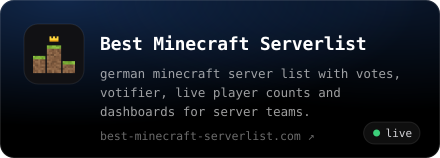
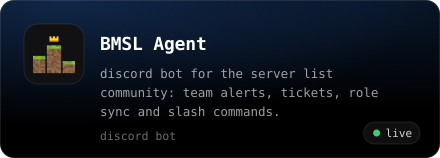
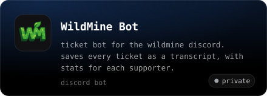
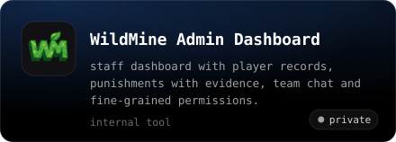
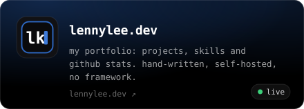
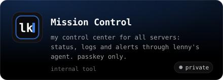

  
  
  
  

i'm lenny, a developer from cologne. i build websites, dashboards and discord bots for minecraft servers and host all of it myself. everything about me lives on **[lennylee.dev](https://lennylee.dev)**.

### Currently building

  
  
  
  
  
  

### Stack

### Activity

most of my code lives in private repos. want to see something? message me on <a href="https://discord.com/users/183614659188883457">discord</a>.
