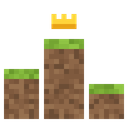
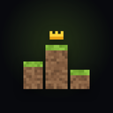
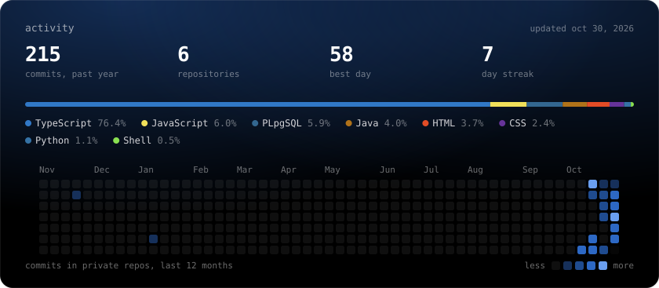

  
  
  
  

i'm lenny, a developer from cologne. i build websites, dashboards and discord bots for minecraft servers and host all of it myself. everything about me and my projects lives on my portfolio: **[lennylee.dev](https://lennylee.dev)**.

### Currently building

<table>
  <tr>
    <td width="56"></td>
    <td><a href="https://best-minecraft-serverlist.com"><b>Best Minecraft Serverlist</b></a> a german minecraft server list with votes, votifier, live player counts and dashboards for server teams.</td>
  </tr>
  <tr>
    <td></td>
    <td><b>WildMine</b> staff dashboard with player records and punishments, plus a ticket bot that saves transcripts.</td>
  </tr>
  <tr>
    <td></td>
    <td><b>BMSL Agent</b> discord bot for the server list community. team alerts, tickets, role sync with the website and slash commands.</td>
  </tr>
  <tr>
    <td></td>
    <td><a href="https://lk.lennylee.dev"><b>lk.lennylee.dev</b></a> my private control center for my servers. only i can sign in, with a passkey.</td>
  </tr>
  <tr>
    <td></td>
    <td><b>Lenny's Agent</b> my personal discord agent. dms me logins, failed sign-ins, ssh logins and outages from all my servers.</td>
  </tr>
</table>

### Stack

### Activity

most of my code lives in private repos. want to see something? message me on <a href="https://discord.com/users/183614659188883457">discord</a>.
